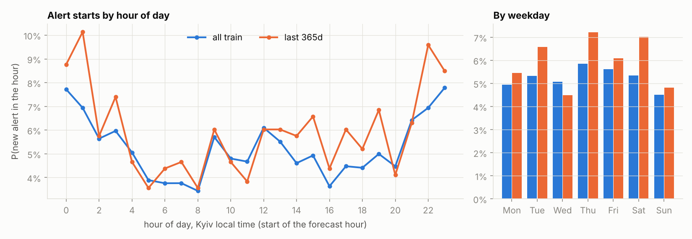
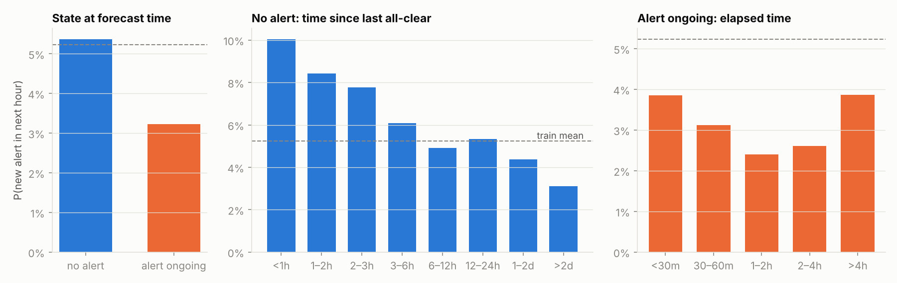
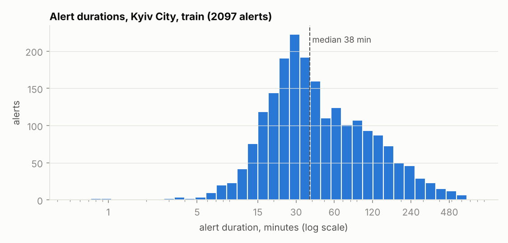
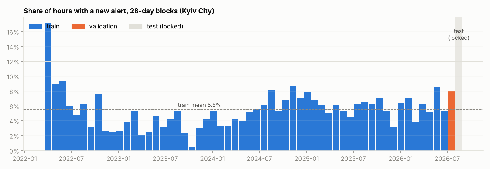
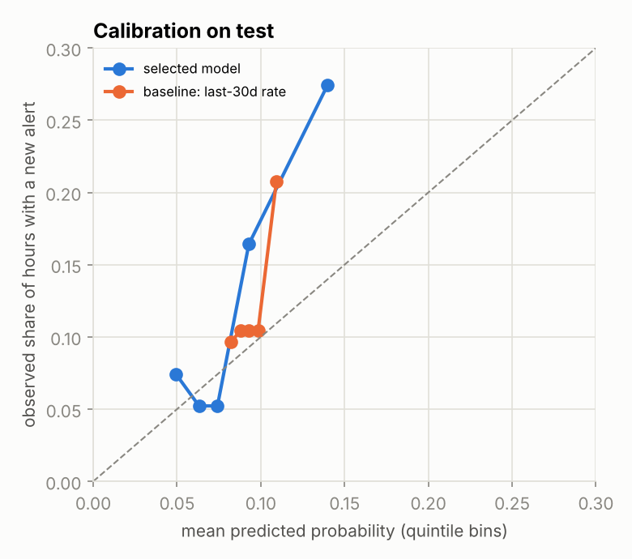
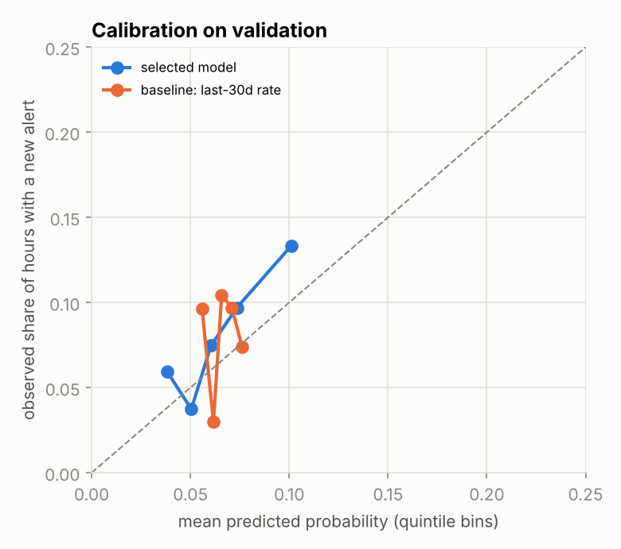
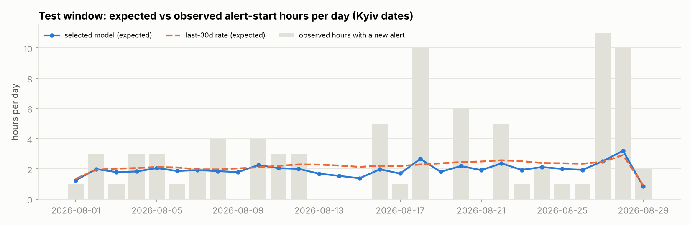

# Kyiv air-raid alerts: next-hour forecast

Will a new air-raid alert start in Kyiv City in the next hour? A small, leakage-safe
time-series project built on the official alerts data from Ukraine, evaluated against
simple baselines on the most recent clean data.

```bash
pip install -r requirements.txt
python run_all.py        # ~2 min: download → grid → tests → EDA → validation → test
```

## Contents

1. [Task and target](#1-task-and-target)
2. [Data and its problems](#2-data-and-its-problems)
3. [Leakage protection and tests](#3-leakage-protection-and-tests)
4. [Train / validation / test and the test lock](#4-train--validation--test-and-the-test-lock)
5. [Results](#5-results)
6. [What went wrong and how we fixed it](#6-what-went-wrong-and-how-we-fixed-it)
7. [Limitations and next steps](#7-limitations-and-next-steps)
8. [How AI was used](#8-how-ai-was-used)
9. [Repository layout](#9-repository-layout)

## 1. Task and target

* **Region:** Kyiv City. Hourly grid in **UTC**; Kyiv local time (`Europe/Kyiv`, DST-aware)
  is used only for calendar features.
* **Forecast time** `t` = top of the hour. **Target** `y[t] = 1` if a *new* alert **starts**
  in `[t, t+1h)`.
* Why “start” and not “alert is active”: with “active”, persistence wins almost for free
  (an alert that is on now is usually still on in an hour), which forecasts nothing.
  “Active in the next hour” is kept only as an EDA column.
* Base rate: 5.2% of hours in train, 8.0% in validation, 12.4% in test.

## 2. Data and its problems

**Source:** [Vadimkin/ukrainian-air-raid-sirens-dataset](https://github.com/Vadimkin/ukrainian-air-raid-sirens-dataset),
`datasets/official_data_en.csv`. The repository is updated daily, so the download is **pinned to
commit `bf0c323c78e3e4508721458797dcd38c95df13f3`** (2026-10-11) and both CSVs are verified by SHA-256
(`src/download.py`).

| Issue | What we found | What we did |
|---|---|---|
| **Duplicated block** | 113,845 of 299,275 rows are exact duplicates: exactly 50% of every month from 03.2022 to 25.01.2026, a contiguous repeated block of the file. Kyiv City: 4,141 rows → 2,267 alerts. | Drop exact duplicates; assert no duplicates remain by `(oblast, raion, hromada, started_at)`. Without this, every count feature before 2026 would be doubled — a fake shift exactly at the train/test boundary. |
| **Collection gap 29.08 04:55 – 02.09 13:48 UTC** | 104.9 h with no alert starting anywhere in Ukraine. The volunteer file has 159–180 alerts per day (5–8 in Kyiv) on those days → missing data, not calm. | Rule “country-wide silence ≥ 24 h = gap”, **checked against the volunteer file over the whole history** in code: across 1,636 days, official data has zero alerts while volunteer data has ≥ 5 regions on exactly 3 days, all inside this gap. Hours whose label touches the gap are excluded; hours whose history touches it are flagged. |
| **File ends 2026-09-07 05:39 UTC** | Last Kyiv alert 05.09 23:22; on 06.09 there were 364 alerts in 14 other oblasts → the Kyiv silence is real. | Grid ends at 2026-09-07 05:00, so every label window is fully covered. |
| **Level change** | Since late 2025 most alerts are declared per raion. | Kyiv City is 100% `level = oblast` over the whole period → the target is homogeneous. |
| **Anomalies** | Kyiv: 6 alerts < 1 min, 4 pairs separated by < 1 min; no zero/negative or > 24 h durations (those exist in frontline oblasts). | Keep short alerts (they are real alerts); merge pairs separated by < 1 min. |

**Why not the volunteer data?** It is fresher, but it is a different source: for Kyiv its start
times match the official ones poorly, and part of the alerts without an all-clear were filled with an
artificial 30-minute duration (`naive` flag). Mixing it in would change the target definition
mid-series. We use it only as an independent coverage check.

## 3. Leakage protection and tests

Information set at time `t` (`src/features.py`):

* only alerts that **started strictly before `t`**;
* an all-clear is used only if it already happened (`finished_at <= t`). For an ongoing alert we
  know *that* it is on and how long it has lasted, but **not** when it will end.

Event times enter the feature code in exactly two places:

```python
n_started = np.searchsorted(starts, t, side="left")   # alerts with start <  t
n_ended   = np.searchsorted(ends,   t, side="right")  # alerts with end   <= t
n_ongoing = n_started - n_ended                       # started before t, no all-clear yet
```

Rolling counts cover `[t − w, t)`. Targets live in a separate function (`build_target`) that
the features never call.

**Tests** (`tests/`, plain Python and also runnable under pytest):

1. **Truncation invariance:** for 750 time points — random times, grid hours, and edge cases
   (exactly at an alert start, +1 ns, mid-alert, exactly at the all-clear, +1 ns) — delete everything
   that started at or after `t` and replace the all-clear of the ongoing alert with a fake one
   10 years ahead. Features are unchanged in every case (109 of the points are inside ongoing alerts).
2. **Reference implementation:** the vectorised code matches a slow, obvious pandas implementation
   on 450 time points, which catches off-by-one errors.
3. An alert starting exactly at `t` is a **target** at `t`, not a feature.
4. **Mutation check:** a deliberately leaky feature (all-clear taken from the future) makes test 1 fail.
5. **Time zone:** `hour_local` comes from `tz_convert("Europe/Kyiv")`, not a fixed +3. Checked on
   29.03.2026 (00:00 / 01:00 UTC → 02:00 / 04:00 local) and 26.10.2025 (both → 03:00 local).

## 4. Train / validation / test and the test lock

| Part | Window (UTC) | Hours | Positive hours | Use |
|---|---|---|---|---|
| train | 2022-03-15 → 2026-07-04 04:00 | 36,995 (after the 30-day warm-up) | 5.2% | fitting |
| validation | 2026-07-04 04:00 → 2026-08-01 04:00 | 672 | 54 (8.0%) | **all** decisions: model, features, history length, calibration |
| test | 2026-08-01 04:00 → 2026-08-29 04:00 | 672 | 83 (12.4%) | opened **once** at the end |
| tail | 2026-09-02 14:00 → 2026-09-07 05:00 | 111 | 21 | supplementary only; history features damaged by the gap |

* The test window is the last 28 days **before the gap**. The 28 days before the cut-off would
  have lost 106 hours to the gap and had damaged 7/30-day history in most of the rest.
* `src/splits.py`: test and tail can only be read through `unlock_test()`, which requires
  `KSE_UNLOCK_TEST=1` and appends every access to `results/test_access.log`. `run_all.py` sets the
  variable for the final script only. The log of the published run shows one test access and one tail access.
* Every fit set is produced by `fit_rows()`, which asserts that the last training label window ends
  before the evaluation window starts.
* Selection rule, fixed in code before any results were seen: **lowest validation log-loss**.
  Three earlier 28-day windows (April–June 2026) were evaluated as an out-of-sample backtest **for
  stability only**.

## 5. Results

### EDA (train only)

| | |
|---|---|
|  |  |
|  |  |

* **Hour of day:** a night peak at 22:00–02:00 local (up to 10% over the last year) against 3.5% at
  05:00–08:00. The profile drifts year to year: the 2022 profile is uncorrelated with later years.
* **Strongest structure — time since the last all-clear:** 10.1% within 1 h, 3.1% after 2 days.
  Alerts come in waves.
* **Ongoing alert:** 3.2% vs 5.4% without one, because a *new* start needs the current alert to end first.
* **Activity level:** P(y) rises monotonically with starts in the last 7 / 30 days (3.1% → 7.1%
  between the lowest and highest quintile).
* **Weekday:** weak and unstable, so it is noise.
* **Durations:** median 38 min, shrinking from 49 min (2022) to 30 min (2026).
* On the dynamics chart the test block was left blank until the final evaluation.

### Models

* **Logistic regression** and **HistGradientBoostingClassifier**.
* History lengths: all / last 12 months / last 6 months.
* Three feature sets:
  * `base`: time since last all-clear and since last start, ongoing flag, log-counts of starts in
    24 h / 7 d / 30 d, two harmonics of the local hour;
  * `+short+elapsed`: plus counts over 1 / 3 / 6 h and elapsed time of the ongoing alert;
  * `+dow`: plus weekday.
* **Selected on validation:** logistic regression, all history, `base+short+elapsed`.
* The final model is refit on train + validation.

### Validation (selection), 54 positive hours

| | ROC-AUC | PR-AUC | Brier | Log-loss | mean pred |
|---|---|---|---|---|---|
| **Selected: logreg, all, base+short+elapsed** | **0.615** | 0.125 | **0.0733** | **0.2767** | 6.5% |
| constant (train rate) | 0.500 | 0.080 | 0.0747 | 0.2865 | 5.2% |
| persistence P(y \| y[t−1]) | 0.527 | 0.087 | 0.0746 | 0.2859 | 5.3% |
| yesterday P(y \| y[t−24]) | 0.501 | 0.081 | 0.0747 | 0.2865 | 5.3% |
| hour-of-day rate, 6 months | 0.551 | 0.125 | 0.0739 | 0.2813 | 6.3% |
| last-30-day rate | 0.525 | 0.088 | 0.0741 | 0.2811 | 6.6% |

Paired day-block bootstrap on validation, log-loss difference model − baseline:
[−0.014, +0.005] vs last-30-day rate and [−0.021, +0.009] vs hour-of-day (6 m). **Within noise.**
In the out-of-sample backtest all-history logistic models (~0.232) beat the best baseline (0.236).
HGB was comparable there (0.2305) and slightly worse on validation, so the rule kept logistic regression.

### Test (opened once), 83 positive hours

| | ROC-AUC | PR-AUC | Brier | Log-loss | mean pred |
|---|---|---|---|---|---|
| **Model** | **0.693** | **0.243** | **0.1057** | **0.3618** | 8.4% |
| constant (train rate) | 0.500 | 0.124 | 0.1132 | 0.4107 | 5.3% |
| persistence P(y \| y[t−1]) | 0.512 | 0.127 | 0.1131 | 0.4097 | 5.3% |
| yesterday P(y \| y[t−24]) | 0.529 | 0.133 | 0.1129 | 0.4077 | 5.4% |
| hour-of-day rate, all | 0.594 | 0.163 | 0.1126 | 0.4058 | 5.3% |
| hour-of-day rate, 12 months | 0.592 | 0.164 | 0.1113 | 0.3957 | 6.1% |
| hour-of-day rate, 6 months | 0.610 | 0.172 | 0.1107 | 0.3909 | 6.3% |
| last-30-day rate | 0.582 | 0.189 | 0.1084 | 0.3746 | 9.4% |

All baselines were refit on exactly the same data as the final model (train + validation, last
hour 2026-08-01 03:00 UTC). `src/audit_baselines.py` prints each baseline's fit window without
reading test labels (log: `results/logs/audit_baselines.txt`).

The two reference baselines were fixed in advance on validation (best log-loss and best ROC-AUC).
Paired day-block bootstrap, 2,000 resamples, model − baseline:

| vs | Log-loss diff, 95% CI | ROC-AUC diff, 95% CI |
|---|---|---|
| last-30-day rate | **[−0.024, −0.003]** | **[+0.041, +0.213]** |
| hour-of-day rate (6 m) | **[−0.064, −0.002]** | [−0.036, +0.174] |

Accuracy at 0.5 is not reported as a comparison metric: no forecast exceeds 0.5, so every method
scores 1 − base rate (0.877 on test).

| | |
|---|---|
|  |  |



**Calibration:** the model **under-forecasts** on test, with a mean prediction of 8.4% against an
observed 12.4%. It expected 56 positive hours and saw 83 (z = 3.6). Its ranking is right: the top quintile has
27% positives against 5–7% in the bottom three. We decided on validation not to recalibrate: the
validation gap was not significant (z = 1.6), and a calibrator fitted on validation could not be
applied cleanly to a model refit on train + validation. On test that cost calibration. We did not try
an intercept shift post hoc, because choosing among variants on the test window would make it
another validation set.

**Tail 02.09–07.09** (supplementary, 21 positives, history features damaged by the gap): model
ROC-AUC 0.69 and log-loss 0.49, against 0.51–0.60 for the baselines. The last-30-day rate collapses
to an AUC of 0.28 there, because its 30-day count includes the missing days. See `results/tail_metrics.csv`.

### Conclusions

* **The gain over the baselines is modest.** On validation the log-loss gain was within noise;
  only the ROC-AUC gain was clear. On test the model beats both pre-registered baselines on log-loss,
  with intervals excluding zero, and reaches ROC-AUC 0.69 against 0.58–0.61. The probabilities stay
  low (≤ 15–25%) and under-calibrated when activity rises. This is a risk score, not an alarm.
* **Why it is still an honest, useful result:**
  1. Every number comes from a pipeline that provably cannot see the future: tests, a locked test window
     and an access log.
  2. The baselines were strong and chosen in advance, and the selection rule was fixed before the
     results were seen.
  3. Uncertainty is reported, not hidden.
  4. The model's value comes from interpretable structure: time since the last all-clear (waves),
     the activity level, and the night peak.
  5. A model that “wins big” on alert data at this horizon would be more suspicious than a modest one.
     Most alert timing is driven by information outside this dataset (launches, drone tracks).

## 6. What went wrong and how we fixed it

1. **Duplicated block in the source file.** Found in step 1: half of all rows before February 2026
   were exact copies. Fixed by deduplication with an assertion, before any feature was built.
2. **Hidden collection gap 29.08–02.09.** Found in step 2 from country-wide silence and confirmed
   against the volunteer file. This moved the test window away from the last 28 days. The ≥ 24 h rule
   is now enforced by a data check over the whole history rather than assumed.
3. **We peeked at the test window once, before it was locked.** When choosing the test window in step 2,
   the script printed the test's positive rate (12.4%) and number of starts, and the manual labelling
   check used an alert of 18.08, which lies in the test window. This could not be undone. Afterwards
   the test was locked in code, the manual check moved to validation, and EDA used train only. The
   number did not drive any modelling choice: history length, features and calibration were chosen
   on validation. But it was seen, so we report it.
4. **Backtest audit.** Before opening the test we checked whether the backtest windows were
   in-sample, which would make the “HGB comparable” remark invalid. They were not: models and
   baseline tables for each window were fit only on data before that window. An explicit assertion
   (`fit_rows`: last training label window ends before the evaluation window) now guards it, and the
   re-run reproduced identical numbers.
5. **Baseline audit before submission.** The question: were the baselines on test refit on
   train + validation like the model, or left on train only? The suspicion came from the
   6-month hour-of-day rate having the same mean forecast on validation and test (6.25% vs 6.27%) although July
   had 8.0%. The audit shows they were refit. The 6-month window moved by 28 days: it dropped
   03.01–31.01.2026 (7.9%) and added validation (8.0%), so its average barely changed.
   No fix and no re-run of the test evaluation were needed, so `test_access.log` still shows a single test access.
6. **Smaller items:** pandas 3 parses timestamps as microseconds, which broke the leakage test until
   we pinned nanoseconds. `pytest` and `pyarrow` were not installable in the build environment, so
   tests are plain functions (pytest-compatible) and the grid is stored as `csv.gz`.

## 7. Limitations and next steps

* **Short evaluation:** 83 positive hours in test and 54 in validation, so intervals are wide.
  A rolling-origin evaluation over many windows would give tighter estimates.
* **Non-stationarity:** the model under-forecasts when activity rises. Next: recency weighting,
  or a calibration step validated over several windows.
* **Signal ceiling:** only Kyiv's own alert history is used. Next, all legal at forecast time:
  alerts in neighbouring and frontline oblasts in the last hours (wave propagation), news or Telegram
  posts published before `t`, a 6-hour horizon.
* **Source dependence:** the official file stops on 07.09.2026 and has gaps. A production version would
  need a live feed and gap detection.

## 8. How AI was used

The project was built with two separate Claude chats. One wrote the code and ran it. The second
independently re-checked every conclusion against the data and formulated corrections. I made
all decisions and confirmed each step before the next one started. Key places where the
independent check caught or changed something:

* **Duplicates.** Re-counting confirmed the 50% duplicated block. It also added the requirement
  to assert that no duplicates remain by `(oblast, raion, hromada, started_at)`.
* **The 6 September check.** The code chat said Kyiv's silence on 06.09 could not be verified from the
  file. The reviewer pointed out that it can: alerts in other oblasts that day prove the day was
  collected. The check is now in `step1_inspect.py`.
* **Gap vs volunteer data.** The reviewer cross-checked the official and volunteer files day by day over
  the whole history. As a result, the “≥ 24 h silence = gap” rule became a data-backed assertion
  in code instead of an assumption.
* **Validation window and test lock.** The reviewer required a separate validation window, all
  decisions on validation only, and the test opened once. This led to `splits.py`, `unlock_test()`
  and the access log. The code chat also admitted, and the README records, that the test's positive rate
  had already been seen in step 2.
* **Backtest audit.** The reviewer asked whether the backtest windows were in-sample, which would
  invalidate the “HGB comparable” remark. The code showed they were out-of-sample. An explicit
  assertion was added and the numbers reproduced exactly.
* **Baseline audit.** The reviewer asked whether the test baselines were refit on train +
  validation. They were (see section 6). The audit script is now part of `run_all.py`.

Target definition (alert *start*, not “alert active”), the choice of test window B, the
no-recalibration decision and the time budget (no text data) were my calls. Where the AI and I
disagreed, the disagreement and its outcome are in this README.

## 9. Repository layout

```
run_all.py                one command: everything from scratch
requirements.txt
src/download.py           pinned dataset commit + SHA-256 check
src/data.py               loading, dedup, gap detection + volunteer cross-check, merging
src/features.py           hourly grid, target, leakage-safe features
src/splits.py             train / validation / test windows, fit_rows(), test lock
src/modeling.py           baselines, models, metrics, bootstrap, reliability
src/step1_inspect.py      data audit
src/step2_build_grid.py   grid + checks
src/step3_eda.py          EDA (train only)
src/step4_validate.py     baselines and models on validation + backtest
src/audit_baselines.py    fit windows of every baseline (reads no test labels)
src/step5_test.py         the one final test evaluation + tail
tests/                    leakage and time-zone tests
results/                  metrics tables, selected config, test access log, step logs
figures/                  charts
```
